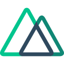

[website]: https://elguendouz-ayoub.com/
[linkedin]: https://www.linkedin.com/in/ayoub-elg/

# Hi, I'm [Ayoub][website]

- ☁️ Cloud Engineer GCP & Fullstack Developer — Freelance
- 🏢 Previously at [Google Cloud](https://cloud.google.com/?hl=fr), [Spendesk](https://spendesk.com/) and [CFO Connect](https://www.cfoconnect.eu/)
- 🎓 Certified GCP: Professional Cloud Architect, Associate Cloud Engineer, Digital Leader
- 📫 Contact me on [Linkedin][linkedin]

## My last projects

<table>
  <tr>
    <td width="50%" valign="top">
      <h3><a href="https://github.com/ayoub9360/openfile">📂 Open File</a></h3>
      
Self-hosted document management with an optional AI assistant. Organize files, search their contents, and ask questions with answers linked to your documents. Store originals locally or in Google Drive.

    </td>
    <td width="50%" valign="top">
      <h3><a href="https://github.com/ayoub9360/job-pulse">🔔 Job Pulse</a></h3>
      
Self-hosted job monitoring with configurable searches and filters. Track matching opportunities across job sources and receive new matches in Discord, with persistent notification history to avoid duplicates.

    </td>
  </tr>
  <tr>
    <td width="50%" valign="top">
      <h3><a href="https://github.com/ayoub9360/agent-switch">🔀 Agent Switch</a></h3>
      
Manage Claude Code and Codex instructions, skills, MCP servers, and hooks from one local interface. Review diffs before applying changes, with backups and conflict detection. Get started with <code>npx @ayoub9360/agent-switch@latest</code>.

    </td>
    <td width="50%" valign="top">
      <h3><a href="https://github.com/ayoub9360/stash-bookmark"> Stash — AI Bookmark Manager</a></h3>
      
Self-hosted AI bookmark manager. Paste a link, it summarizes, categorizes, tags, and makes it searchable in natural language. No accounts. No tracking. Your data stays on your machine.

    </td>
  </tr>
  <tr>
    <td width="50%" valign="top">
      <h3><a href="https://github.com/google/devlibrary"> DevLibrary</a></h3>
      
Google Dev Library is a content library of open source projects and technical blogs featuring Google technologies authored and contributed by developers from around the world.

    </td>
    <td width="50%" valign="top">
      <h3><a href="https://github.com/ayoub9360/Speech-To-Text-Benchmark"> Speech To Text Benchmark</a></h3>
      
This initiative empowers you to rigorously assess and benchmark the Word Error Rate (WER) across various state-of-the-art Speech-to-Text (STT) models, offered by Google's and OpenAI's platforms.

    </td>
  </tr>
  <tr>
    <td width="50%" valign="top">
      <h3><a href="https://spendesk.com/"> Spendesk</a></h3>
      
Spend management platform that combines payments, approvals, expenses, and accounting automation into one solution.

    </td>
    <td width="50%" valign="top">
      <h3><a href="https://www.cfoconnect.eu/"> CFO Connect</a></h3>
      
The largest community of finance leaders in Europe, providing resources, events, and networking for CFOs.

    </td>
  </tr>
  <tr>
    <td width="50%" valign="top">
      <h3><a href="https://github.com/ayoub9360/font-explorer">🔤 Font Explorer</a></h3>
      
Explore and preview fonts easily. Try it live at <a href="https://font.cool.elguendouz-ayoub.com/">font.cool.elguendouz-ayoub.com</a>

    </td>
    <td width="50%" valign="top">
      <h3><a href="https://elguendouz-ayoub.com"> Portfolio</a></h3>
      
&lt;/&gt; and Crafted with 💛 by Ayoub El Guendouz

    </td>
  </tr>
</table>

## Tech

**AI / Agents**

 `LangGraph` ·  `LangChain` ·  `AI SDK` ·  `MCP` ·  `Tool Calling` ·  `RAG` ·  `Agentic RAG` ·  `OpenWebUI` ·  `Hugging Face` ·  `Vertex AI`

**Languages**

 `TypeScript` ·  `Python`

**Backend**

 `FastAPI` ·  `Node.js` ·  `Fastify` ·  `Express`

**Frontend**

 `React` ·  `Next.js` ·  `Vue.js` ·  `Nuxt.js`

**Data & Retrieval**

 `PostgreSQL` ·  `pgvector`

**Infrastructure / CI/CD**

 `Docker` ·  `Terraform` ·  `GitHub Actions` ·  `CI/CD` ·  `GCP` ·  `AWS`

**LLMOps / Evaluation**

 `Langfuse`

## Current interests

`AI Agents` · `Agent Infrastructure` · `RAG` · `MCP` · `Context Engineering` · `Retrieval` · `LLM Evaluation` · `LLMOps` · `Enterprise AI`

## Links

[ **Portfolio**][website] · [ **LinkedIn**][linkedin]
